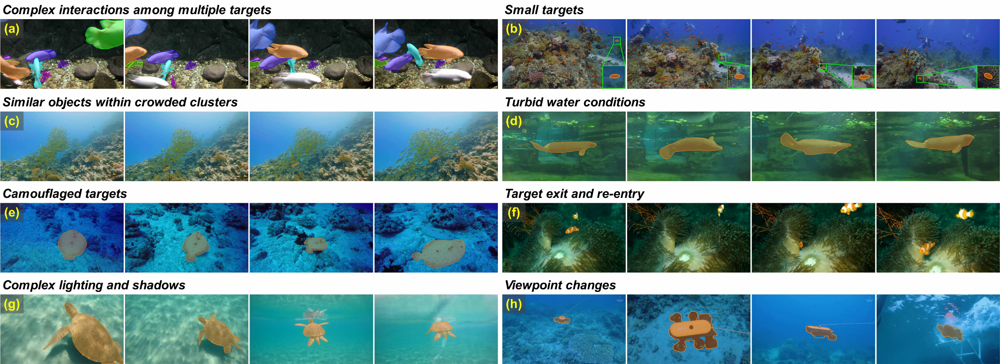

# UW-VOS

Official repository for **Video Object Segmentation under Aquatic Domain Shift: A Diagnostic Benchmark and Restoration Adapter**.

Hongshen Zhao, Jingkang Tai, Yuhang Wu, Wenkang Zhang, Xi Lan, Shangyan Wang, Tianyu Zhang, and Wankou Yang

*Pattern Recognition*, 2026

[](https://doi.org/10.1016/j.patcog.2026.115218)
[](https://arxiv.org/abs/2603.24006)
[](https://www.modelscope.cn/datasets/hszh42/UW-VOS)
[](https://github.com/hszh/vos-benchmark)



*Representative videos from UW-VOS. Colored masks highlight the target objects. [View the original figure (PDF).](assets/uw-vos-examples.pdf)*

## Overview

**UW-VOS** is a large-scale diagnostic benchmark for underwater video object segmentation. It studies how aquatic image formation affects object appearance, mask localization, and identity preservation across video frames.

| Video sequences | Mask annotations | Semantic categories | Fine-grained attributes |
| ---: | ---: | ---: | ---: |
| 1,431 | 307,267 | 411 | 16 |

The benchmark supports analysis of three factors: **aquatic appearance degradation**, **spatial localization ambiguity**, and **temporal identity discontinuity**. Its annotations are produced through a semi-automatic data engine with human verification.

## Dataset

The dataset is available on **[ModelScope: hszh42/UW-VOS](https://www.modelscope.cn/datasets/hszh42/UW-VOS)**.

Please follow the README on the dataset page for downloads, file organization, and data preparation. Refer to that page for dataset usage terms as well.

## Evaluation

We use **[hszh/vos-benchmark](https://github.com/hszh/vos-benchmark)** for evaluation. Please follow its README for installation and usage.

## Citation

If you use UW-VOS in your research, please cite:

```bibtex
@article{zhao2026uwvos,
  title={Video object segmentation under aquatic domain shift: A diagnostic benchmark and restoration adapter},
  author={Zhao, Hongshen and Tai, Jingkang and Wu, Yuhang and Zhang, Wenkang and Lan, Xi and Wang, Shangyan and Zhang, Tianyu and Yang, Wankou},
  journal={Pattern Recognition},
  volume={183},
  pages={115218},
  year={2026},
  doi={10.1016/j.patcog.2026.115218}
}
```

## Acknowledgements

Our evaluation code builds on [vos-benchmark](https://github.com/hkchengrex/vos-benchmark). We thank the authors for making their work available.
